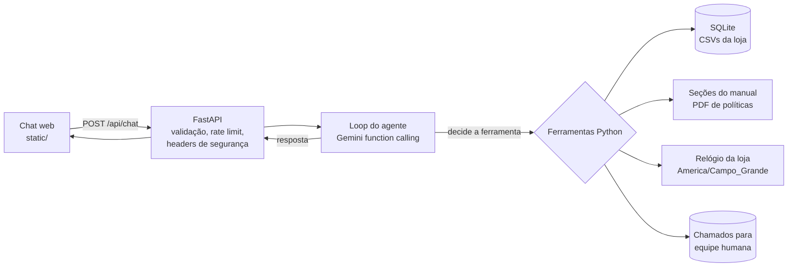

# Empório da Música — Agente de Atendimento

Protótipo de agente de atendimento por mensagens de texto para a **Empório da Música**, loja fictícia de instrumentos musicais em Campo Grande/MS (desafio técnico AI Engineer — Artefact).

O agente responde dúvidas de catálogo (preço, estoque, promoções, PIX e parcelamento), consulta pedidos com verificação de identidade, aplica as políticas da loja (trocas, devoluções, garantia, frete, horários), recusa com educação o que está fora do escopo e encaminha para a equipe humana com protocolo quando não consegue resolver.

## Sumário

- [Como rodar](#como-rodar)
- [Arquitetura](#arquitetura)
- [Decisões técnicas](#decisões-técnicas)
- [Segurança e privacidade](#segurança-e-privacidade)
- [Tratamento dos dados e suposições](#tratamento-dos-dados-e-suposições)
- [Testes](#testes)
- [Deploy na Vercel](#deploy-na-vercel)
- [Exemplos de conversa](#exemplos-de-conversa)
- [Limitações e próximos passos](#limitações-e-próximos-passos)
- [Uso de assistentes de código](#uso-de-assistentes-de-código)

## Como rodar

Pré-requisitos: Python 3.11+ e uma chave gratuita do Gemini ([Google AI Studio](https://aistudio.google.com/apikey)).

```bash
python -m venv .venv
# Windows
.venv\Scripts\activate
# macOS / Linux
source .venv/bin/activate

pip install -r requirements.txt

# Windows
copy .env.example .env
# macOS / Linux
cp .env.example .env
# edite .env e preencha GEMINI_API_KEY

uvicorn app.main:app --host 127.0.0.1 --port 8000
```

Abra <http://127.0.0.1:8000>. Para ver quais ferramentas o agente chamou em cada resposta (com dados pessoais ocultados), abra <http://127.0.0.1:8000/?review=1>. Esse modo só existe fora de produção.

Variáveis de ambiente opcionais estão documentadas em [`.env.example`](.env.example) (modelo, limites de uso, CORS etc.).

### API

- `GET /api/health` — `{"status": "ok" | "degraded"}`
- `POST /api/chat` — corpo `{"message": "...", "history": [{"role": "user|assistant", "content": "..."}]}`; resposta `{"reply": "...", "activity": [{"label": "...", "detail": "..."}]}`

## Arquitetura



| Ferramenta | Quando o agente usa |
|---|---|
| `search_products` | Busca por palavras, categoria e faixa de preço (preço final, já com promoção) |
| `get_product_details` | Preço, promoção, PIX, parcelamento, specs; alternativas se indisponível |
| `list_categories` | O que a loja vende |
| `get_order_status` | Status do pedido, com nome completo ou telefone; prazos de troca/devolução/garantia já calculados |
| `get_store_policies` | Trechos do manual: trocas, frete, pagamento, garantia, promoções, privacidade |
| `get_store_profile` | Endereço, contatos, horário e se a loja está aberta agora |
| `create_support_ticket` | Reclamação, cancelamento, defeito ou caso não resolvido: gera protocolo |

```text
app/
  main.py       # FastAPI: rotas, validação, headers, tratamento de erros
  agent.py      # loop de function calling com o Gemini
  tools.py      # ferramentas (SQL, políticas, pedidos, chamados)
  prompts.py    # persona, regras e contexto atual
  policies.py   # PDF -> seções pesquisáveis
  clock.py      # fuso da loja, horário de funcionamento
  db.py         # CSVs -> SQLite
  security.py   # rate limit, teto diário, redação de dados, detecção de injeção
  config.py     # configuração por variáveis de ambiente
static/         # interface do chat (HTML/CSS/JS sem framework)
tests/          # pytest, sem chamadas reais ao LLM
data/           # CSVs e PDF fornecidos no desafio
examples/       # conversas reais com o agente
scripts/        # record_examples.py: regrava os exemplos com o modelo configurado
```

## Decisões técnicas

**Abordagem híbrida: function calling com ferramentas determinísticas.** Dados estruturados (preço, estoque, pedido) precisam ser exatos — o próprio manual diz que informação errada "pode configurar propaganda enganosa". Por isso o LLM nunca recebe a tabela inteira nem faz contas: ele decide *qual* ferramenta chamar e *como* comunicar o resultado. Preço no PIX, parcelamento máximo, preço promocional e prazos de devolução/garantia são calculados em Python e testados.

**Sem agente de SQL livre.** Um agente que gera SQL teria acesso à tabela de clientes e abriria espaço para vazamento de dados via prompt injection. Ferramentas com parâmetros tipados limitam o que o modelo consegue consultar e permitem aplicar autorização em código.

**Políticas: recuperação por seção, sem embeddings.** O manual tem 8 páginas e 10 seções bem definidas. Dividir por seção e buscar por palavras-chave é mais simples, barato, determinístico e fácil de depurar que um RAG vetorial. O modelo recebe a seção inteira, então não perde contexto de regras que dependem umas das outras (ex.: PIX x promoção). Com um corpus maior, o próximo passo seria embeddings + reranking.

**Loop próprio em vez de LangChain/LlamaIndex.** São ~150 linhas: modelo decide → Python executa → modelo responde, com limite de rodadas. Menos dependências, comportamento explícito e fácil de testar com um cliente falso (ver `tests/test_agent.py`).

**Modelo: Gemini Flash-Lite (`gemini-3.5-flash-lite` por padrão).** Comecei com o `gemini-2.5-flash`, mas a camada gratuita dele (5 requisições/minuto e 20/dia no momento do desenvolvimento) não sustenta nem a gravação dos exemplos — cada mensagem do cliente usa de 2 a 3 requisições (chamada de ferramenta + resposta). Gravei os mesmos cenários com o Flash-Lite e conferi as respostas: acertou as regras de preço, PIX, prazos, identificação de pedido e escopo. Como os números vêm das ferramentas, o agente não precisa do modelo mais forte; precisa de function calling confiável, bom português e latência baixa. O modelo é configurável por `GEMINI_MODEL` (ex.: um Flash maior em produção com faturamento ativo); temperatura baixa (0,3) para respostas consistentes.

**Prompt.** O system prompt define persona (tom do manual: "amigo que entende de música"), escopo, qual ferramenta é fonte de verdade para cada assunto, regras de preço/promoção, privacidade, fluxo de atendimento da política 7.2 e regras de segurança. A cada turno é anexado o **contexto atual** (data/hora de Campo Grande, loja aberta ou fechada, próxima abertura), necessário para "fora do expediente, informe o horário de retorno". As descrições das ferramentas complementam o prompt com instruções de uso.

**Interface: FastAPI + HTML/JS puro.** Mantém o projeto 100% Python no backend, sem build de frontend, e permite deploy simples. O painel "Consultamos" mostra ao cliente quais fontes foram usadas (transparência) sem expor dados brutos.

**Histórico de conversa.** O cliente guarda a conversa em `sessionStorage` (sobrevive a um recarregamento, some ao fechar a aba) e envia as últimas mensagens a cada requisição; o servidor é stateless e corta o histórico para as 12 últimas mensagens. Isso evita banco de sessões no protótipo e não guarda conversas de clientes no servidor (LGPD). A autorização de pedidos é feita pela ferramenta a cada chamada, então um histórico forjado não libera dados.

## Segurança e privacidade

- **Pedidos (LGPD):** exigem número do pedido + **nome completo** (ignorando acentos, maiúsculas e partículas como "da") ou **telefone com DDD**. A resposta para "pedido não existe" e "identificação não confere" é idêntica, evitando enumeração de pedidos. Telefone e e-mail do cliente nunca são devolvidos.
- **Prompt injection:** a proteção real está no código (ferramentas tipadas, autorização em Python, sem SQL livre). Como defesa adicional, mensagens com padrões de injeção (português e inglês) são marcadas como entrada não confiável e o prompt instrui a ignorá-las.
- **Abuso e custo:** rate limit por IP, teto diário de chamadas ao LLM, limite de tamanho da mensagem e do corpo da requisição, limite de rodadas de ferramentas e de tokens de saída.
- **IP do cliente:** `X-Forwarded-For` só é considerado atrás de um proxy confiável (`TRUST_PROXY_HEADERS`, ativo automaticamente na Vercel, que sobrescreve o header).
- **Erros:** o cliente recebe mensagens genéricas; detalhes ficam no log do servidor. Em produção a documentação OpenAPI e o modo de revisão ficam desativados.
- **Navegador:** CSP restritiva, `X-Frame-Options: DENY`, `nosniff`, `no-referrer`; respostas do modelo são escapadas antes de renderizar (só `**negrito**` vira HTML).
- **Segredos:** apenas via variáveis de ambiente; `.env` está no `.gitignore` e no `.vercelignore`.

## Tratamento dos dados e suposições

- Os CSVs são carregados em SQLite na inicialização, com chaves estrangeiras (verifiquei que não há registros órfãos).
- Busca sem acento e com plural simples ("violao" encontra "Violões") via função de normalização registrada no SQLite.
- Só promoções com `is_active = 1` são consideradas. Promoção inativa citada pelo cliente é tratada como encerrada (política 7.3).
- **Data de recebimento:** o dataset não tem data de entrega real, então uso `estimated_delivery` como data de recebimento para os prazos de arrependimento (7 dias), troca por preferência (7 dias) e garantia legal (90 dias). Troca por defeito (30 dias) conta da data da compra, como diz o manual.
- **Direito de arrependimento:** o manual o restringe a compras online; assumo que os pedidos do dataset são online (todos têm fluxo de envio).
- **Parcelamento:** a tabela da seção 3 diz "até 12x, parcela mínima de R$ 100", mas a seção 3.1 detalha faixas (até 3x, 4–6x com mínimo R$ 80, 7–12x com mínimo R$ 100). Usei a 3.1, mais específica, interpretando "exceto abaixo de R$ 50,00" como parcela mínima de R$ 50 até 3x. Preço promocional não recebe desconto de PIX, mas pode ser parcelado.
- **Telefones:** o manual traz (67) 3341-4444 como telefone/WhatsApp na capa e na seção 1.2, e (67) 3321-4500 como WhatsApp na seção 7. Mantive os dois como estão escritos, sem "corrigir" o documento.
- **E-mail:** na seção 1.2 aparece com acento (`empóriodamusica`); usei a grafia da capa, sem acento, que é um domínio válido.
- **Feriados:** o manual não traz calendário; o agente avisa que feriados podem alterar o horário em vez de inventar.
- Status e formas de pagamento do CSV (em inglês) são traduzidos para português antes de chegar ao modelo.

## Testes

```bash
pip install -r requirements-dev.txt
pytest
```

57 testes, sem chamadas reais ao LLM: autorização de pedidos, prazos de pós-venda, busca, regras de preço, horário de funcionamento, validações da API, redação de dados pessoais, rate limit e o loop do agente com um cliente Gemini simulado.

## Deploy na Vercel

O projeto roda na Vercel sem adaptação de código (`app/main.py` é detectado como app FastAPI):

1. Importe o repositório na Vercel.
2. Configure `GEMINI_API_KEY` em *Environment Variables* (opcional: `DAILY_CHAT_LIMIT`, `GEMINI_MODEL`).
3. Deploy.

Na Vercel o app entra automaticamente em modo produção, usa `/tmp` para o SQLite e confia no IP informado pela plataforma. Os chamados ficam em `/tmp`, portanto são temporários (ver limitações).

## Exemplos de conversa

Conversas reais com o agente (`gemini-3.5-flash-lite`), com as ferramentas usadas em cada resposta:

1. [Catálogo: violões até R$ 1.000 e indicação para iniciante](examples/01-catalogo-violoes-ate-1000.md)
2. [Preço com promoção ativa, PIX não cumulativo e parcelamento](examples/02-preco-promocao-pix.md)
3. [Devolução aplicada a um pedido real, com prazos calculados](examples/03-devolucao-pedido.md)
4. [Status de pedido com verificação de identidade](examples/04-status-pedido-identificacao.md)
5. [Horário, fora do escopo e tentativa de prompt injection](examples/05-escopo-horario-seguranca.md)

Para regravar: `python scripts/record_examples.py` (respeita o limite de requisições da camada gratuita).

## Limitações e próximos passos

- **Chamados e rate limit em memória/arquivo local:** em produção iriam para um banco gerenciado (ex.: Postgres) e um helpdesk/CRM, com rate limit compartilhado (ex.: Redis).
- **Sem canal WhatsApp real:** a API já é independente da interface; o próximo passo seria um webhook do WhatsApp Business chamando o mesmo `chat()`.
- **Identidade simplificada:** nome completo ou telefone é suficiente para um protótipo; em produção usaria código de verificação enviado ao telefone/e-mail do pedido.
- **Busca por palavras-chave:** funciona bem para 65 produtos; com catálogo maior, usaria busca semântica para pedidos vagos ("violão bom para criança").
- **Avaliação:** os testes cobrem as ferramentas de forma determinística; faltaria um conjunto de avaliação das respostas do LLM (perguntas de referência + verificação automática de preços citados, recusa de escopo, não vazamento de dados).
- **Streaming** das respostas para reduzir a percepção de latência.
- **Feriados** e horários especiais configuráveis.

## Uso de assistentes de código

Usei o **Cursor** (agente com modelo Claude) como par de programação durante todo o projeto. Fluxo:

1. **Entendimento:** li o enunciado e o manual; usei o agente para extrair o texto do PDF e perfilar os CSVs (status de produtos, promoções ativas, pedidos por status, registros órfãos). Isso levantou as inconsistências documentadas acima.
2. **Arquitetura:** discuti as alternativas (RAG vetorial, agente SQL, function calling) e escolhi ferramentas determinísticas pelo requisito de precisão e privacidade.
3. **Implementação incremental:** dados → ferramentas → loop do agente → API → interface, revisando cada contrato de ferramenta.
4. **Revisão crítica:** pedi ao agente uma revisão do projeto contra o enunciado, com foco em segurança e UX, e validei cada achado com scripts antes de corrigir. Achados reais que viraram commits: a verificação de identidade do pedido aceitava uma única letra como nome; a conversa quebrava na 8ª mensagem por limite de histórico; a busca não encontrava "violao" sem acento; o agente não sabia a data atual para aplicar prazos de devolução.
5. **Testes:** os testes foram escritos junto com as correções para fixar cada comportamento.

O histórico de commits mostra essa evolução. Revisei o código gerado, as regras de negócio contra o manual e as afirmações deste README.
