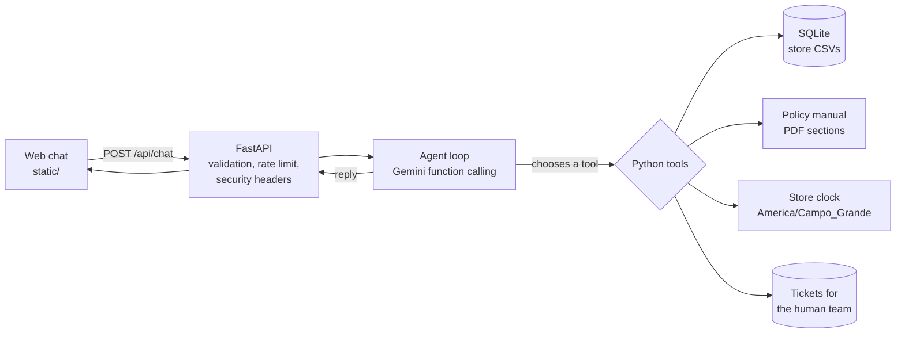

# Empório da Música — Customer Service Agent

A text-based customer service agent for **Empório da Música**, a fictional musical-instrument store in Campo Grande, Brazil (Artefact AI Engineer technical case).

The agent answers catalog questions (price, stock, promotions, PIX and installments), looks up orders after verifying the customer's identity, applies store policy (exchanges, returns, warranty, shipping, opening hours), politely declines anything outside the store's scope, and opens a ticket for the human team when it cannot resolve the request.

The agent, the chat interface and the sample dialogues are in Portuguese, the language of the store and its customers. This README is in English, as required by the submission instructions.

## Contents

- [How to run](#how-to-run)
- [Architecture](#architecture)
- [Technical decisions](#technical-decisions)
- [Security and privacy](#security-and-privacy)
- [Data handling and assumptions](#data-handling-and-assumptions)
- [Tests](#tests)
- [Deploying on Vercel](#deploying-on-vercel)
- [Sample conversations](#sample-conversations)
- [Limitations and next steps](#limitations-and-next-steps)
- [Use of coding assistants](#use-of-coding-assistants)

## How to run

Requirements: Python 3.11+ and a free Gemini API key ([Google AI Studio](https://aistudio.google.com/apikey)).

```bash
python -m venv .venv
# Windows
.venv\Scripts\activate
# macOS / Linux
source .venv/bin/activate

pip install -r requirements.txt

# Windows
copy .env.example .env
# macOS / Linux
cp .env.example .env
# edit .env and set GEMINI_API_KEY

uvicorn app.main:app --host 127.0.0.1 --port 8000
```

Open <http://127.0.0.1:8000>. To see which tools the agent called for each reply (with personal data redacted), open <http://127.0.0.1:8000/?review=1>. That mode is disabled in production.

Optional environment variables are documented in [`.env.example`](.env.example) (model, usage limits, CORS and so on).

### API

- `GET /api/health` — `{"status": "ok" | "degraded"}`
- `POST /api/chat` — body `{"message": "...", "history": [{"role": "user|assistant", "content": "..."}]}`; response `{"reply": "...", "activity": [{"label": "...", "detail": "..."}]}`

## Architecture



| Tool | When the agent uses it |
|---|---|
| `search_products` | Search by words, category and price range (final price, promotion already applied) |
| `get_product_details` | Price, promotion, PIX, installments, specs; alternatives when unavailable |
| `list_categories` | What the store sells |
| `get_order_status` | Order status, with full name or phone; exchange, return and warranty deadlines already calculated |
| `get_store_policies` | Sections of the manual: exchanges, shipping, payment, warranty, promotions, privacy |
| `get_store_profile` | Address, contacts, opening hours and whether the store is open right now |
| `create_support_ticket` | Complaint, cancellation, defect or an unresolved case: issues a protocol number |

```text
app/
  main.py       # FastAPI: routes, validation, headers, error handling
  agent.py      # Gemini function-calling loop
  tools.py      # tools (SQL, policies, orders, tickets)
  prompts.py    # persona, rules and the current store context
  policies.py   # PDF -> searchable sections
  clock.py      # store timezone and opening hours
  db.py         # CSVs -> SQLite
  security.py   # rate limit, daily cap, redaction, injection detection
  config.py     # configuration from environment variables
static/         # chat UI (HTML/CSS/JS, no framework)
tests/          # pytest, no real LLM calls
data/           # CSVs and PDF provided with the case
examples/       # real conversations with the agent
scripts/        # record_examples.py: re-records the samples with the configured model
```

## Technical decisions

**Hybrid approach: function calling with deterministic tools.** Structured data (price, stock, orders) has to be exact. The store manual itself says that wrong information can amount to misleading advertising. The LLM never sees the whole table and never does the arithmetic: it decides *which* tool to call and *how* to phrase the result. PIX price, maximum installments, promotional price and return/warranty deadlines are computed in Python and covered by tests.

**No free-form SQL agent.** An agent that writes SQL would have access to the customers table and could leak data through prompt injection. Tools with typed parameters limit what the model can query, and authorization is enforced in code.

**Policies: section retrieval, no embeddings.** The manual is 8 pages and 10 well-defined sections. Splitting it by section and matching keywords is simpler, cheaper, deterministic and easier to debug than vector RAG. The model receives the whole section, so rules that depend on each other stay together (for example, PIX versus an active promotion). With a larger corpus, the next step would be embeddings plus reranking.

**A small custom loop instead of LangChain or LlamaIndex.** About 150 lines: the model decides, Python executes, the model answers, with a cap on rounds. Fewer dependencies, explicit behavior, and easy to test with a fake client (see `tests/test_agent.py`).

**Model: Gemini Flash-Lite (`gemini-3.5-flash-lite` by default).** I started with `gemini-2.5-flash`, but its free tier at the time of development (5 requests per minute and 20 per day) cannot even record the sample conversations. Each customer message costs 2 or 3 requests (tool call plus the reply). I recorded the same scenarios with Flash-Lite and checked the answers: it got the price rules, PIX, deadlines, order identification and scope right. Because the numbers come from the tools, the agent does not need the strongest model. It needs reliable function calling, good Portuguese and low latency. The model is configurable through `GEMINI_MODEL` (for example a larger Flash model in production, with billing enabled). Temperature is 0.3, for consistent replies.

**Prompt.** The system prompt defines the persona (the manual's tone: "a friend who understands music"), the scope, which tool is the source of truth for each topic, price and promotion rules, privacy, the service flow from policy 7.2, and the security rules. Every turn appends the **current context** (date and time in Campo Grande, whether the store is open, and the next opening). That is required for "outside business hours, tell the customer when we return". The tool descriptions add usage instructions on top of the prompt.

**Interface: FastAPI plus plain HTML/JS.** The backend stays entirely Python, there is no frontend build, and deployment stays simple. The "Consultamos" panel shows the customer which sources were used, without exposing raw data.

**Conversation history.** The browser keeps the conversation in `sessionStorage` (it survives a reload and disappears when the tab is closed) and sends the latest messages with each request. The server is stateless and keeps only the last 12 messages. That avoids a session store in the prototype and does not keep customer conversations on the server (LGPD, the Brazilian data-protection law). Order authorization runs inside the tool on every call, so a forged history cannot unlock data.

## Security and privacy

- **Orders (LGPD):** require the order number plus the **full name** (accents, case and particles such as "da" are ignored) or a **phone number with area code**. "Order not found" and "identity does not match" return the same message, so orders cannot be enumerated. The customer's phone and email are never returned.
- **Prompt injection:** the real protection is in the code (typed tools, authorization in Python, no free-form SQL). As an extra layer, messages that match injection patterns (Portuguese and English) are marked as untrusted input, and the prompt tells the model to ignore them.
- **Abuse and cost:** per-IP rate limit, a daily cap on LLM calls, limits on message size and request body size, and caps on tool rounds and output tokens.
- **Client IP:** `X-Forwarded-For` is trusted only behind a trusted proxy (`TRUST_PROXY_HEADERS`, turned on automatically on Vercel, which overwrites the header).
- **Errors:** the client gets a generic message; details stay in the server log. In production, the OpenAPI docs and the review mode are disabled.
- **Browser:** a strict Content-Security-Policy, `X-Frame-Options: DENY`, `nosniff` and `no-referrer`. Model replies are escaped before rendering (only `**bold**` becomes HTML).
- **Secrets:** environment variables only. `.env` is listed in `.gitignore` and `.vercelignore`.

## Data handling and assumptions

- The CSVs are loaded into SQLite at startup, with foreign keys. I checked that there are no orphan rows.
- Search ignores accents and a simple plural ("violao" finds "Violões") through a normalization function registered in SQLite.
- Only promotions with `is_active = 1` count. An inactive promotion mentioned by the customer is treated as ended (policy 7.3).
- **Delivery date:** the dataset has no actual delivery date, so I use `estimated_delivery` as the receipt date for the cooling-off period (7 days), preference exchange (7 days) and legal warranty (90 days). Defect exchange (30 days) is counted from the purchase date, as the manual says.
- **Cooling-off right:** the manual limits it to online purchases. I assume the orders in the dataset are online, because every one of them has a shipping flow.
- **Installments:** the table in section 3 says "up to 12 installments, minimum installment of R$ 100", but section 3.1 gives the bands (up to 3 installments, 4–6 with a minimum of R$ 80, 7–12 with a minimum of R$ 100). I followed 3.1, which is more specific, and read "except below R$ 50.00" as a minimum installment of R$ 50 for up to 3 installments. A promotional price does not also get the PIX discount, but it can be paid in installments.
- **Phone numbers:** the manual lists (67) 3341-4444 as the phone/WhatsApp on the cover and in section 1.2, and (67) 3321-4500 as WhatsApp in section 7. I kept both as written, instead of "correcting" the document.
- **Email:** section 1.2 spells it with an accent (`empóriodamusica`). I used the cover spelling, without the accent, which is a valid domain.
- **Holidays:** the manual has no calendar. The agent says that holidays may change the hours, instead of inventing them.
- CSV statuses and payment methods (in English) are translated to Portuguese before they reach the model.

## Tests

```bash
pip install -r requirements-dev.txt
pytest
```

57 tests, with no real LLM calls: order authorization, after-sales deadlines, search, price rules, opening hours, API validation, redaction of personal data, rate limiting, and the agent loop with a fake Gemini client.

## Deploying on Vercel

The project runs on Vercel without code changes (`app/main.py` is detected as a FastAPI app):

1. Import the repository on Vercel.
2. Set `GEMINI_API_KEY` under Environment Variables (optional: `DAILY_CHAT_LIMIT`, `GEMINI_MODEL`).
3. Deploy.

On Vercel the app automatically runs in production mode, uses `/tmp` for SQLite and trusts the IP reported by the platform. Tickets live in `/tmp`, so they are temporary (see limitations).

## Sample conversations

Real conversations with the agent (`gemini-3.5-flash-lite`). Each file notes the tools used in every reply. The dialogue is in Portuguese, unchanged from what the agent actually said.

1. [Catalog: acoustic guitars up to R$ 1,000, then a recommendation for a beginner](examples/01-catalogo-violoes-ate-1000.md)
2. [Price with an active promotion, non-cumulative PIX discount and installments](examples/02-preco-promocao-pix.md)
3. [A return applied to a real order, with deadlines calculated from the current date](examples/03-devolucao-pedido.md)
4. [Order status with identity verification](examples/04-status-pedido-identificacao.md)
5. [Opening hours, an out-of-scope request and a prompt-injection attempt](examples/05-escopo-horario-seguranca.md)

To record them again: `python scripts/record_examples.py` (it respects the free-tier request limit).

## Limitations and next steps

- **Tickets and rate limiting are in memory or a local file.** In production they would go to a managed database (for example Postgres) and a helpdesk or CRM, with a shared rate limit (for example Redis).
- **No real WhatsApp channel.** The API is already independent of the interface. The next step would be a WhatsApp Business webhook calling the same `chat()`.
- **Simplified identity check.** A full name or a phone number is enough for a prototype. In production I would send a verification code to the phone or email on the order.
- **Keyword search.** It works well for 65 products. With a larger catalog I would add semantic search for vague requests ("a good guitar for a child").
- **Evaluation.** The tests cover the tools deterministically. What is still missing is an evaluation set for the LLM replies: reference questions plus automatic checks that quoted prices are correct, out-of-scope requests are refused, and no personal data leaks.
- **Streaming.** The chat reveals the reply word by word, but the model still returns the full text in one response. Token streaming would shorten the wait before the first word.
- **Holidays** and special opening hours are not configurable.

## Use of coding assistants

I used **Cursor** (an agent backed by Claude) as a programming partner throughout the project. The workflow:

1. **Understanding.** I read the case and the manual. I used the agent to extract the PDF text and profile the CSVs (product statuses, active promotions, orders by status, orphan rows). That is what surfaced the inconsistencies documented above.
2. **Architecture.** I discussed the alternatives (vector RAG, a SQL agent, function calling) and chose deterministic tools because of the accuracy and privacy requirements.
3. **Incremental implementation.** Data, then tools, then the agent loop, then the API, then the interface, reviewing each tool contract as I went.
4. **Critical review.** I asked the agent to review the project against the case, focusing on security and UX, and I checked each finding with scripts before changing anything. Real findings that became commits: order identity verification accepted a single letter as a name; the conversation broke on the 8th message because of the history limit; search missed "violao" without the accent; the agent did not know the current date, so it could not apply return deadlines.
5. **Tests.** Tests were written together with the fixes, to lock each behavior in.

The commit history shows that progression. I reviewed the generated code, the business rules against the manual, and the statements in this README.
